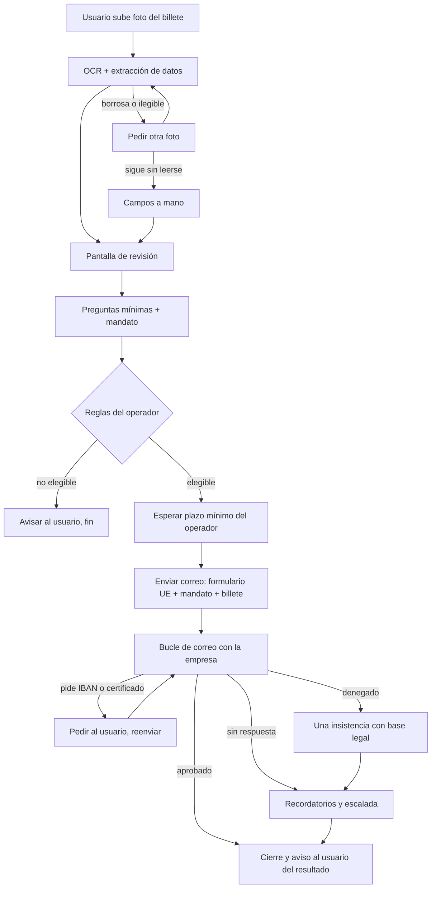

# Retren: arquitectura

Retren reclama por correo, con IA, las indemnizaciones por retraso de tren. El usuario sube la foto del billete y responde muy pocas preguntas. Retren gestiona todo con la empresa hasta que hay resultado.

Proyecto para i-Hack 2026 (BYU-Idaho), categoría International, tema "Re-Invent".

## Alcance

- **Operadores**: Iryo, Renfe y Ouigo, con la misma arquitectura. Como todo va por correo y no por formularios web, el flujo es idéntico para todos; lo único que cambia es la configuración de cada operador (sus políticas, que son reglas deterministas). Añadir un operador es añadir una configuración, no código nuevo. Condición: que el operador tenga un correo donde acepte reclamaciones. Hoy solo Iryo lo tiene confirmado; Renfe y Ouigo están pendientes de confirmarlo (ver sección 3).
- **Modelo**: gratis en la fase de validación. El cobro por éxito (5%) queda para más adelante.
- **Demo**: simulada, sin reclamaciones reales. Las pruebas reales solo con un billete propio o de alguien del equipo que dé su consentimiento.

## Lo que NO hacemos

- No automatizamos los formularios web de los operadores (los de Iryo y Renfe llevan reCAPTCHA) y sortearlo no es válido (ni con esperas "humanas", ni con servicios de resolución, ni llamando a su endpoint interno).
- No usamos billetes inventados ni de terceros.
- El dinero nunca pasa por Retren: la devolución va al usuario.

## Flujo

## Componentes

### 1. Formulario del usuario

Se sube la foto y se pregunta lo mínimo. Lo que la IA lee del billete no se pregunta: solo se confirma en la pantalla de revisión.

**Se pregunta siempre**

| Dato                                    | Para qué                                                          |
| --------------------------------------- | ----------------------------------------------------------------- |
| Tipo y número de documento              | Lo piden los operadores (Iryo lo exige; el formulario europeo no) |
| Email del usuario                       | Solo para avisos: pedir un documento o comunicar el final         |
| Hora real de llegada                    | No sale en el billete; decide si hay derecho y qué tramo          |
| ¿Ya reclamaste este viaje por otra vía? | Apartado 2 del formulario europeo                                 |
| Dinero o vale                           | Apartado 5.4 del formulario europeo                               |
| Aceptación del mandato y casilla RGPD   | Autoriza a Retren; genera el PDF de autorización                  |

**Se pregunta solo si la IA no lo encuentra en el billete**: compañía, fecha, origen, destino, localizador, nº de billete, nombre y apellidos, hora prevista de salida y de llegada. Nº de tren y precio quedan en blanco si no salen.

**Nunca por defecto (en blanco hasta que la empresa los pida)**: dirección, teléfono, IBAN, SWIFT, titular de la cuenta, información adicional, hora real de salida.

Regla: la IA no rellena nada que el usuario no haya dado.

### 2. Lectura del billete

- **Google Cloud Vision**: OCR de la foto.
- **Gemini Flash-Lite**: convierte el texto en campos (JSON) y señala los que faltan. Comprobar que el modelo siga disponible con ese nombre.
- Foto borrosa: se pide otra. Si no hay forma, se rellenan a mano.
- La pantalla de revisión es obligatoria: la empresa valida contra su base de datos y un localizador mal leído hace fallar la reclamación.

### 3. Configuración por operador y reglas de elegibilidad (deterministas, sin IA)

Es lo único que cambia entre operadores. Cada configuración está versionada, con fecha y enlace a su fuente, e incluye:

- canal y dirección de reclamaciones (correo, o formulario web/postal si no hay correo) y tiempo de respuesta típico (para los temporizadores);
- espera mínima, tope y tramos de indemnización;
- exclusiones (fuerza mayor, limitaciones de velocidad de Adif, compra por intermediario);
- forma de devolución (dinero, vale);
- plantillas de correo.

Entrada de las reglas: operador, fecha del viaje, hora prevista y real de llegada, fecha de compra y canal de compra si se conocen. Salida: elegible, no elegible o dudoso, con el motivo.

| Regla                             | Iryo                                                                                                                          | Renfe                                                              | Ouigo                                                                                                                                  |
| --------------------------------- | ----------------------------------------------------------------------------------------------------------------------------- | ------------------------------------------------------------------ | -------------------------------------------------------------------------------------------------------------------------------------- |
| Canal de reclamación              | Correo: atencion.cliente@iryo.eu (también teléfono 910 150 000 y formulario web)                                              | Formulario web / Portal de Reclamaciones. **Correo no confirmado** | Formulario web (ouigo.zendesk.com) o carta a Calle Alfonso XII 62, Madrid. **Correo no encontrado**                                    |
| Respuesta                         | 1 mes (3 como máximo)                                                                                                         | 1 mes (3 como máximo)                                              | 1 mes (menos de 3 como máximo)                                                                                                         |
| Espera mínima                     | 48 h tras el viaje                                                                                                            | 24 h tras la llegada                                               | No publicada. Ouigo avisa y paga por su cuenta, así que se espera 7 días y solo se reclama si no ha llegado el vale (decisión nuestra) |
| Tope                              | 3 meses desde el viaje: no publican plazo y este es el límite legal para reclamar (Reglamento 2021/782, art. 28)              | 3 meses desde el viaje                                             | Sin plazo publicado para pedir la indemnización; se aplican los 3 meses legales. Cambiar un vale por abono en tarjeta: 6 meses         |
| Tramos                            | "Al menos 60 min" abre el derecho; 50% por más de 60 min, 100% por más de 90 min (60 min justos: dudoso, se envía igualmente) | 60 min o más: 50%. Más de 90 min: 100%                             | 30–59 min: 50% en vale no reembolsable. 60–89 min: 50% en vale reembolsable. 90 min o más: 100% en vale reembolsable                   |
| Forma de pago                     | Vale primero; dinero si se pide expresamente                                                                                  | Dinero o vale                                                      | Siempre vale; el vale reembolsable puede cambiarse por tarjeta solo hasta el importe legal                                             |
| Fuerza mayor                      | Sin indemnización (decide la empresa: se envía igualmente). Iryo indemniza los retrasos "por causas imputables a iryo"        | Ídem                                                               | Ídem                                                                                                                                   |
| Limitaciones de velocidad de Adif | Sin indemnización según fecha de compra                                                                                       | Sin derecho en billetes comprados desde el 31/01/2026              | Mantiene su política                                                                                                                   |
| Intermediario o Casa Iryo         | Solo vale                                                                                                                     | A revisar                                                          | A revisar                                                                                                                              |

Mínimos europeos de referencia (Reglamento 2021/782, art. 19): 25% del billete entre 60 y 119 min y 50% desde 120 min, pagados en un mes; las empresas pueden fijar un umbral de hasta 4 € por billete. La exención por circunstancias extraordinarias no cubre las huelgas del personal de la propia empresa ni los fallos de otras empresas o del administrador de infraestructura (Adif): sirve de argumento en una insistencia. Si el billete no indica la fecha de compra, la regla de Adif no se aplica y decide la empresa.

**Estado de cada configuración** (fuentes: condiciones de cada operador, consultadas el 13/11/2026)

- **Iryo**: completa. Su política publicada no fija plazo máximo; se usa el límite legal de 3 meses.
- **Renfe**: reglas completas, pero **no hay correo de reclamaciones confirmado**: su web solo muestra formulario y Portal de Reclamaciones. Hay que pedirlo por teléfono o preguntarlo (ver Pendiente).
- **Ouigo**: reglas completas, pero **su canal es un formulario web o una carta, no un correo**. No lo automatizamos (el formulario está tras una protección anti-bot). Hasta confirmar un correo con ellos, Ouigo queda fuera del envío automático: en la demo se simula, y en producción se les pregunta qué dirección aceptan.

Un operador no se activa hasta tener su canal confirmado. Solo en DEV, un operador puede enrutarse a un buzón de pruebas del equipo mediante `MAIL_OPERATOR_INBOXES` para probar a mano; en producción sigue haciendo falta una dirección confirmada.

### 4. Generación de documentos

- **Formulario europeo** (Reglamento de Ejecución (UE) 2024/949): PDF rellenable en español publicado por la Comisión, 47 campos. Los nombres internos están en italiano y uno en inglés: se mapean por su texto de ayuda en español, no por orden. Mapeo verificado visualmente rellenando cada campo con su número y renderizando el PDF (ver "Mapeo del formulario").
- **Autorización de representación (mandato)**: PDF corto con los datos del caso. Debe permitir presentar la reclamación, insistir y escalar. No permite aceptar condiciones distintas ni cobrar.
- **Billete** original, como adjunto.

### 5. Envío y bucle de correo

- Se envía desde un correo de Retren, con un identificador de caso en cada hilo.
- Cuerpo: texto corto y personalizado (3 o 4 líneas de plantilla) con los datos al estilo del formulario del operador, incluido el número de documento de identidad. Firma: "Retren, en representación de [nombre]". No se hace pasar por una persona.
- Adjuntos: formulario europeo, mandato y billete.
- La IA clasifica cada respuesta de la empresa en categorías cerradas y responde con plantillas.
- Cada caso tiene un estado: borrador, esperando plazo, enviado, respuesta recibida, esperando al usuario, escalado, resuelto, denegado o cerrado.

**Cómo se "encierra" la IA**

1. Solo clasifica en un conjunto fijo: acuse, pide datos, aprobada, denegada, remite al formulario, otro.
2. Cada categoría tiene una plantilla; la IA rellena huecos, no redacta libremente.
3. Solo responde a direcciones del operador dentro del hilo del caso y solo adjunta documentos predefinidos.
4. Lo que no entiende va a una cola del equipo de Retren, no al usuario.
5. Los correos de la empresa son datos, no órdenes: nunca se obedece una instrucción que venga dentro (por ejemplo, "envíe sus datos a otra dirección").

### 6. Seguimiento y escalada (temporizadores)

| Desde el envío         | Acción                                                                             |
| ---------------------- | ---------------------------------------------------------------------------------- |
| Día 0                  | Reclamación inicial                                                                |
| Día 12 a 15            | Recordatorio amable (Iryo suele tardar unos 12 días)                               |
| Día 30                 | Recordatorio citando el plazo legal de un mes para responder                       |
| Día 40                 | Último aviso: se escalará si no responden                                          |
| Día 45                 | Escalada: DGTT (pasado un mes desde la reclamación) o Junta Arbitral de Transporte |
| 3 meses desde el envío | Cierre y aviso al usuario                                                          |

- Cada recordatorio es distinto: cita las fechas anteriores, la base legal y lo que se pide.
- Si la empresa contesta, el calendario se para. Si se espera algo del usuario, se pausa.
- Máximo de envíos por caso, para no ser tratados como spam.
- Si deniegan: una insistencia con argumentos concretos y luego escalada o cierre. No se molesta al usuario.
- Los plazos son una propuesta, a ajustar con un caso real.

### 7. Cuándo se escribe al usuario

Solo en estos casos:

1. **La empresa pide algo que solo el usuario tiene** (certificado de titularidad bancaria, IBAN, copia del DNI). La IA le escribe, él responde adjuntándolo (esa respuesta vale como aprobación), Retren lo reenvía solo a la dirección verificada y borra el documento.
2. **Resultado final**: aprobado, denegado o cerrado. Si fue aprobado, se le pide que confirme que recibió el dinero o el vale.
3. **Excepción**: una escalada que exija su nombre o su firma y que el mandato no cubra.

### Archivos del repositorio

| Archivo                          | Qué es                                                                                       | Se sube   |
| -------------------------------- | -------------------------------------------------------------------------------------------- | --------- |
| `templates/formulario_ue_es.pdf` | Formulario europeo en español (accesible, 47 campos). Es la plantilla que rellena la app     | Sí        |
| `templates/formulario_ue_en.pdf` | Versión en inglés, por si algún día se reclama en ese idioma                                 | Opcional  |
| `docs/reglamento_2024_949.pdf`   | Reglamento de Ejecución 2024/949, solo de consulta. Basta una copia (teníamos dos idénticas) | Opcional  |
| `templates/mandato.pdf`          | Autorización de representación. Todavía no existe: se escribe con revisión jurídica          | Pendiente |

Origen de los formularios: Comisión Europea. Anotarlo en el README, porque su reutilización exige atribución.

**Nunca se suben** PDFs rellenados con datos reales, ni tickets de usuarios, ni el archivo de pruebas con los campos "F01, F02…" (solo servía para verificar el mapeo).

### Mapeo del formulario (campo del PDF → dato)

| Campo del PDF                                            | Apartado      | Dato                                                                             |
| -------------------------------------------------------- | ------------- | -------------------------------------------------------------------------------- |
| `Motivi della richiesta 1/2/3` (casillas)                | 1             | Retraso / Cancelación / Pérdida de enlace. Siempre marcar solo Retraso           |
| `Data 1`                                                 | 2.1           | Fecha de solicitud previa (solo si ya reclamó)                                   |
| `Destinatario della richiesta 1`                         | 2.2           | Operador                                                                         |
| `Richiesta precedente 1`                                 | 2.3           | Medios de la solicitud previa (en blanco si no hay)                              |
| `Nome dell'impresa ferroviaria 1`                        | 3.1           | Operador                                                                         |
| `Viaggio previsto 1`                                     | 3.2.1         | Fecha de salida                                                                  |
| `Viaggio previsto 2` / `3`                               | 3.2.2 / 3.2.3 | Estación de origen / destino                                                     |
| `Viaggio previsto 4`                                     | 3.2.4         | Hora prevista de salida                                                          |
| `Scheduled journey 5`                                    | 3.2.5         | Hora prevista de llegada                                                         |
| `Viaggio previsto 6`                                     | 3.2.6         | Nº de tren o categoría                                                           |
| `Viaggio previsto 7`                                     | 3.2.7         | Nº de billete o localizador                                                      |
| `Viaggio previsto 8`                                     | 3.2.8         | Precio                                                                           |
| `Viaggio effettivo 1` / `2` / `3`                        | 3.3.1–3.3.3   | Fecha real de llegada / hora real de salida / hora real de llegada               |
| `Viaggio effettivo 4` / `5`                              | 3.3.4 / 3.3.5 | Nº de tren real / enlace perdido (en blanco)                                     |
| `Specificare la richiesta/le richieste 1`                | 4             | Reintegro del billete (solo cancelación o retraso previsto: no se marca)         |
| `Specificare la richiesta/le richieste 2`                | 4             | **Indemnización: se marca**                                                      |
| `Selezionare una delle 3 opzioni 1` / `2` / `3`          | 4             | 60–119 min / 120 min o más / recurrentes: una sola según la hora real            |
| `Specificare la richiesta/le richieste 3`                | 4             | Reintegro de costes (en blanco)                                                  |
| `Nome 1` / `Nome 2`                                      | 5.1           | Nombre / apellidos                                                               |
| `Indirizzo 1`–`5`                                        | 5.2           | Calle / número / país / código postal / municipio (en blanco hasta que lo pidan) |
| `Dati di contatto 1` / `2`                               | 5.3           | Email usado en la reserva / teléfono (en blanco)                                 |
| `Forma di pagamento preferita 1` / `2`                   | 5.4           | Dinero / vales                                                                   |
| `Estremi del pagamento 1`–`4`                            | 5.5           | IBAN / SWIFT / otros medios / titular (en blanco hasta que lo pidan)             |
| `Informazioni supplementari 1`                           | 6             | Información adicional (en blanco)                                                |
| `Regolamento generale sulla protezione dei dati 1` / `2` | final         | Sí / No: se marca Sí si el usuario aceptó el RGPD                                |
| `Informazioni 1` / `2` / `3`                             | final         | Fecha de la solicitud / lugar / "Retren, en representación de [nombre]"          |

Los estados de las casillas no son homogéneos (la de RGPD "Sí" usa el valor `/Sê`, la de "No" usa `/No`; el resto `/Yes`): al rellenar, leer el valor "activado" de cada casilla en lugar de suponer `/Yes`. Hay que añadir `NeedAppearances` para que el texto se vea al abrir el PDF.

## Aspectos legales y privacidad

El formulario europeo no incluye mandato: solo prevé que lo firme un representante. Hacen falta tres piezas propias, que deben revisarse por un abogado antes de lanzar:

1. **Autorización de representación** (qué puede y qué no puede hacer Retren, duración, revocación, tarifa).
2. **Aviso de privacidad y consentimiento RGPD** (qué datos, para qué, cuánto tiempo, derechos de acceso y borrado).
3. **Condiciones de uso**.

Se guarda evidencia de la aceptación: fecha y hora, versión del texto, IP y datos del viaje.

Se recogen los datos mínimos y se borran en cuanto dejan de hacer falta. Los textos y plazos de este documento resumen una conversación de trabajo y no son asesoramiento jurídico.

## Base legal de referencia

- El operador debe dar una respuesta razonada en un mes (tres meses en casos justificados) y la reclamación se presenta en un plazo de tres meses desde el incidente.
- El formulario europeo es opcional, prevé un representante y puede presentarse por medios electrónicos.
- Si la empresa no responde o deniega, el viajero puede acudir al organismo nacional de ejecución (art. 33); en España, la DGTT, además de la Junta Arbitral de Transporte.
- Una empresa no puede rechazar una solicitud solo por no usar el formulario europeo y, si es imprecisa, debe pedir aclaraciones (art. 19, apdos. 5 y 6).
- Hay obligación de ofrecer un correo para quejas y reclamaciones, pero **el Reglamento 2021/782 no menciona a representantes ni a terceros para reclamar**, así que no existe una obligación legal confirmada de que el operador acepte a Retren. Lo único que lo respalda es el formulario europeo, que prevé la firma "del viajero o de su representante". Es el principal riesgo y hay que comprobarlo con cada operador.

## Pendiente

Resuelto: correo de Iryo; plazo máximo de Iryo (no publicado, se usa el legal de 3 meses); espera mínima y tope de Ouigo (no publicados, ver tabla); lectura del Reglamento 2021/782; mapeo de los 47 campos.

Solo queda lo que requiere a una persona del equipo:

- [ ] Ver un billete real de cada operador (qué campos salen impresos).
- [ ] Llamar o escribir a **Renfe** (912 320 320) y a **Ouigo** para pedir la dirección de correo donde aceptan reclamaciones.
- [ ] Preguntar a los tres operadores si aceptan reclamaciones de un tercero con autorización firmada.
- [ ] Preguntar a Iryo si 60 minutos exactos dan derecho (su texto dice "al menos 60" y "más de 60" a la vez).
- [ ] Subir al repositorio los PDFs de `templates/` (ver "Archivos del repositorio") y anotar la atribución a la Comisión Europea en el README.
- [ ] Revisión jurídica del mandato, la privacidad, las condiciones y el cobro futuro.
- [ ] Preparar la demo con un buzón simulado y respuestas guionizadas de los operadores.
